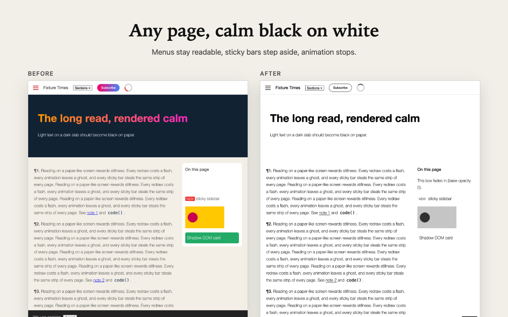
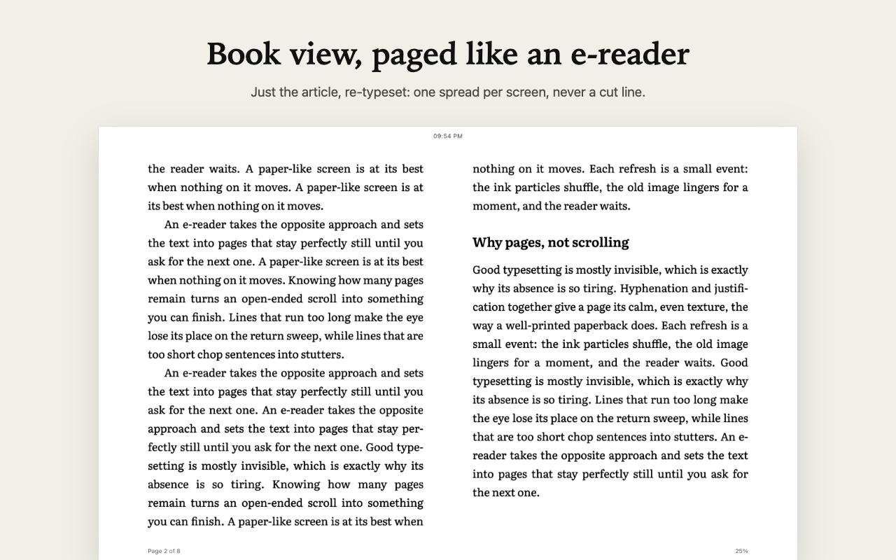
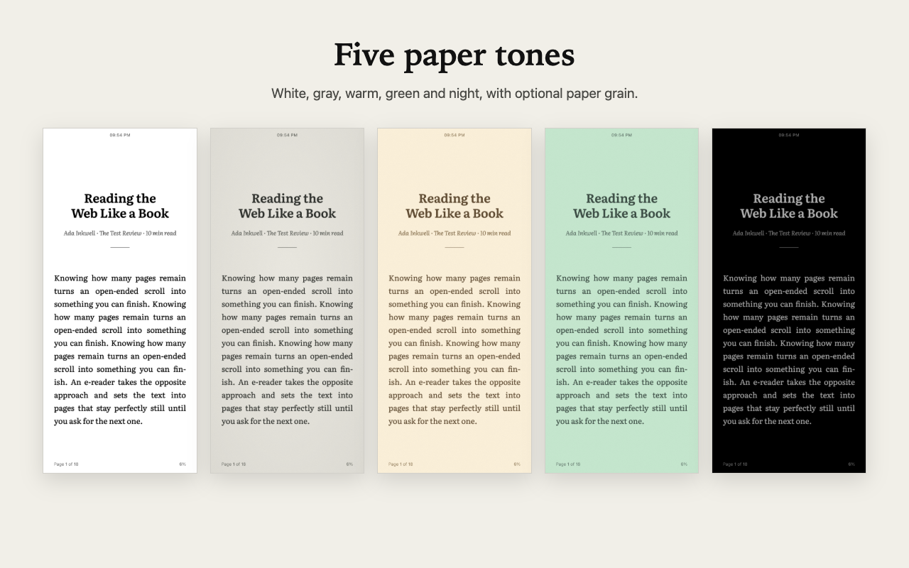
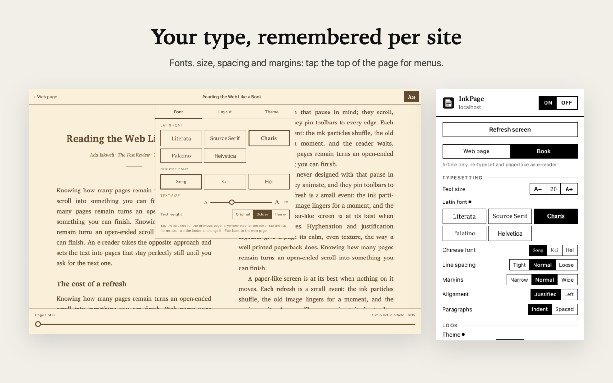

# InkPage — E-ink Reading Mode

[](#install)
[](#install)
[](#install)
[](#install)
[](#install)
[](#install)
[](LICENSE)

English · [中文](README.zh-CN.md)

One click turns any web page into calm black on white for e-ink tablets, paper-like monitors and any screen you want to keep still. Pages turn a screen at a time and never cut a line in half. Book view keeps just the article and typesets it like an e-reader.

Chrome · Edge · Firefox · Safari on macOS, iPhone and iPad. One Manifest V3 code base, no build tools, no tracking.




## Features

**Web page mode** keeps the site's own layout and links.
- Dark backgrounds become paper. Menus, pop-ups and cards that were opaque stay opaque, so text never shows through. Icons, toggles and dividers keep their shape.
- Fixed headers, sticky sidebars and cookie bars stop following the scroll.
- CSS animations jump to their end state, so fade-in content still appears. JavaScript animations pause, muted autoplay video pauses, and GIFs freeze until clicked.
- Works inside Shadow DOM, in apps that scroll an inner pane, and on pages with a strict Content Security Policy.

**Book view** keeps just the article (via Mozilla Readability) and re-typesets it.
- Fonts: Literata, Source Serif, Charis, Palatino and Helvetica for Latin text; Song, Kai and Hei for Chinese.
- Size, line spacing, margins, justification, book-style indents or spaced paragraphs.
- One screen per page, or a two-page spread on wide screens. The footer shows page, progress and time left, and the book reopens where you stopped.
- Tap the top of the page for the toolbars: back to the web page, a page slider and **Aa** with Font / Layout / Theme.

**Page turns that never cut a line.** Space, Page Down, the arrow keys, a tap on the screen edges or one flick of the wheel turns exactly one page. A line cut by the bottom edge opens the next page instead.

**Five paper tones**: white, gray, warm, green and night, with optional paper grain and edge shading.

**For e-ink**: a full-screen refresh to clear ghosting (by hand or every N pages), bolder text for thin web fonts, and a picker to hide page clutter for good.

Every setting is remembered per site. The interface follows the browser language: Chinese (Simplified and Traditional browsers) or English.




## Shortcuts

| Keys | Action |
|---|---|
| `Alt+Shift+E` | Turn InkPage on or off for this site |
| `Alt+Shift+B` | Switch book view |
| `Alt+Shift+R` | Refresh the screen (clear e-ink ghosting) |
| `Space` / `Page Down` / `→` | Next page |
| `Shift+Space` / `Page Up` / `←` | Previous page |
| `Esc` | Book view: close menus, then show the original page |

Keys the site handles itself (video players, editors, slide decks) are left to the site.

## Install

| Browser | Get InkPage |
|---|---|
| Chrome | [Chrome Web Store][chrome] |
| Edge | [Edge Add-ons][edge] |
| Firefox (desktop and Android) | [Firefox Add-ons][firefox] |
| Safari on Mac | [Download InkPage.dmg][mac] |
| Safari on iPhone and iPad | [App Store][ios] |

### Turn it on

- **Chrome, Edge, Firefox**: click the InkPage icon in the toolbar and choose **On**. The page turns black on white; **Book** in the same panel switches to book view. Chrome and Edge may first put the icon under the puzzle-piece button; pin it to keep it in the toolbar.
- **Safari on Mac**: open the DMG, drag InkPage to Applications and open it once. Then tick InkPage in Safari → Settings → Extensions and allow it on websites. The InkPage button appears in Safari's toolbar.
- **Safari on iPhone and iPad**: after installing from the App Store, open Settings → Apps → Safari → Extensions → InkPage (iOS 17: Settings → Safari → Extensions), turn it on and set All Websites to Allow. Back in Safari, tap the page menu button in the address bar on iPhone, or the puzzle-piece button on iPad, then InkPage.

InkPage remembers each site: turn it on once and it stays on there.

<!-- Store links: replace Edge once Edge Add-ons has approved InkPage. -->
[chrome]: https://chromewebstore.google.com/detail/mfokhnbicfnfogkncnajofioiojmbhbg
[edge]: #install
[firefox]: https://addons.mozilla.org/firefox/addon/inkpage-e-ink-reading-mode/
[mac]: https://github.com/wyh0626/inkpage/releases/latest
[ios]: https://apps.apple.com/app/id6830053910

## Privacy

No account, no analytics, no network requests of its own. Settings and reading positions stay in the browser's extension storage. See [PRIVACY.md](PRIVACY.md).

## How it works

- **Colour**: the content script briefly lifts its own overrides to read what each element looked like, with transitions frozen so nothing flickers. Boxes that were opaque become paper and boxes that were see-through stay see-through. Rules carry ID-level specificity so they beat most site `!important` rules. When a page CSP blocks injected `<style>` (Safari does), the same CSS goes in as a constructed stylesheet.
- **Page turns**: `caretPositionFromPoint` / `caretRangeFromPoint` find the text line crossing the bottom edge. The next page starts at that line, and the current page masks its remainder. A second check at the new top edge catches lines that overhang an edge by less than a pixel.
- **Book view**: the article is laid out in CSS columns exactly one screen tall. Columns break only between lines, so no page ever cuts one. Your place is anchored to the paragraph you're reading, so changing the font size keeps it.
- **Calm**: animation durations drop to almost zero instead of `animation: none`, which would strand fade-in content at opacity 0. Transitions drop to zero, so e-ink never paints an in-between frame.

## Development

### Run from source

```bash
npm run build
```

- **Chrome / Edge**: open `chrome://extensions`, turn on Developer mode, choose **Load unpacked** and select `dist/chrome`.
- **Firefox**: open `about:debugging#/runtime/this-firefox`, choose **Load Temporary Add-on** and select `dist/firefox/manifest.json`.
- **Safari (macOS)**: `npm run safari:app` builds a signed `dist/InkPage.app` (no Xcode needed). Open it once, then enable InkPage in Safari → Settings → Extensions. For a quick try without signing: Safari → Settings → Advanced → **Show features for web developers**, then Settings → Developer → **Add Temporary Extension…** and select `dist/safari`.
- **Safari (iPhone / iPad)**: needs full Xcode. `npm run safari:xcode` writes the Xcode project to `safari-app/InkPage`; run it on a simulator or a device from Xcode.

Publishing to the stores, and releasing from GitHub: [docs/publishing.md](docs/publishing.md).

### Layout

```text
src/
  background.js          shortcuts, toolbar badge, loads book view on demand, tells tabs about setting changes
  content/content.js     colour, scanner, calm, page turns, element picker
  content/book.js        book view: extraction, typesetting, pagination, reading position
  shared/settings.js     defaults, per-site settings, paper themes, CSP-proof CSS mounting
  popup/  options/       toolbar popup and options page
  _locales/{en,zh_CN}/   interface text (zh_CN is reused for zh_TW at build time)
  vendor/                Mozilla Readability 0.6.0 (Apache-2.0)
  fonts/                 Literata, Source Serif 4, Charis SIL (SIL OFL)
scripts/                 build, icons, store images, Safari app (no Xcode), Xcode project, i18n check
safari/                  native container app and extension handler for the Mac Safari build
test/                    fixtures, API harness, self test, end-to-end test
store/                   listing copy and images
```

### Tests

Start a server first: `python3 -m http.server 8765` in the project root.

| What | How |
|---|---|
| End to end in Chrome (25 checks) | `npm i -D puppeteer && node test/e2e.mjs` |
| In-page self test, any browser | open `http://localhost:8765/test/fixture.html?ext&selftest` with InkPage on. The result shows in the tab title. |
| Line audit with the API harness | open `test/fixture.html`, then in the console `await inkTest.site({enabled:true}); inkTest.audit(1, '#article')` |
| Book view audit | open `test/article.html`, then `await inkTest.site({enabled:true, mode:'book'}); inkTest.bookAudit()` |
| Interface text | `npm run check:i18n` |
| Firefox lint | `npm run lint:firefox` |

Verified on Chrome 148, Firefox 159 and Safari 26.5. Page turning was also stress-tested at 122 window sizes in both directions with no lost lines.

## Limits

- Browser pages (`chrome://`, store pages, Safari settings) can't be changed by any extension.
- Text drawn over a dark background *image* stays black; choose **Images → Hide** for such sites.
- Book view relies on Readability. Pages that load the article late, or are mostly comments, may come out incomplete; use web page mode there.
- On iPhone and iPad, Safari tints its toolbars from the page's first paint. When InkPage's styles land after that, the bars can keep the site's original colour (a dark or red header, say); the page itself is unaffected.
- No highlights, notes or dictionary yet.

## Credits

[Mozilla Readability](https://github.com/mozilla/readability) (Apache-2.0) · [Literata](https://github.com/googlefonts/literata), [Source Serif 4](https://github.com/adobe-fonts/source-serif), [Charis SIL](https://software.sil.org/charis/) (SIL Open Font License). Licence files are in `src/vendor` and `src/fonts`.

## License

[MIT](LICENSE) © 2026 Eric Wang. The bundled Readability and fonts keep their own licences, listed above.
