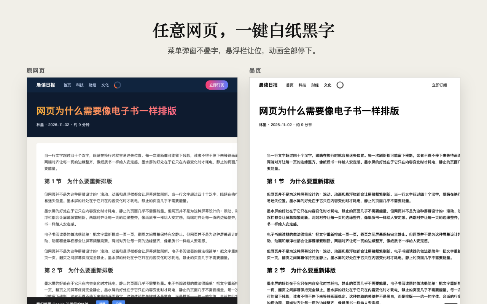
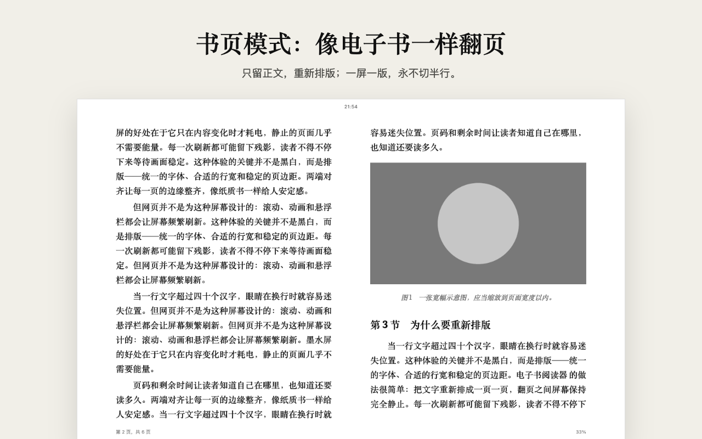
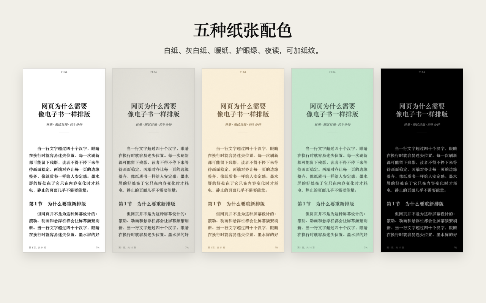
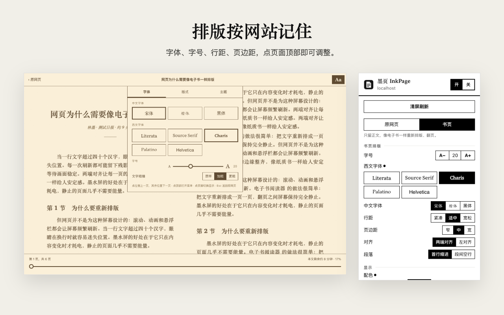

# 墨页 InkPage · 墨水屏阅读模式

[](#安装)
[](#安装)
[](#安装)
[](#安装)
[](#安装)
[](#安装)

[English](README.md) · 中文

一键把任意网页变成安静的白纸黑字，适合墨水屏平板、类纸显示器，以及任何你想让它静下来的屏幕。翻页一次翻一屏，永远不切半行。书页模式只留正文，像电子书一样重新排版。

支持 Chrome、Edge、Firefox，以及 macOS、iPhone、iPad 上的 Safari。一份 Manifest V3 代码，不需要打包工具，不追踪用户。




## 功能

**原网页模式**：保留网站原本的版式和链接。
- 深色背景变成纸色。原本不透明的菜单、弹窗、卡片仍然不透明，文字不会透出来叠在一起；图标、开关、分隔线保持原样。
- 固定顶栏、吸顶侧栏、cookie 条不再跟着页面滚动。
- CSS 动画直接跳到结束状态，淡入的内容照常出现；JS 动画暂停，静音自动播放的视频暂停，GIF 定格，点击才播放。
- 支持 Shadow DOM、在内部容器里滚动的网页应用，以及设置了严格 CSP 的网站。

**书页模式**：用 Mozilla Readability 提取正文，重新排版。
- 字体：西文可选 Literata、Source Serif、Charis、Palatino、Helvetica；中文可选宋体、楷体、黑体。
- 字号、行距、页边距、两端对齐、首行缩进或段间空行，都能调。
- 一屏一页，宽屏是双页对开。页脚显示页码、进度和剩余阅读时间，下次打开回到上次读到的地方。
- 点页面顶部出现工具栏：返回原网页、拖动跳页的进度条，以及 **Aa**（字体 / 版式 / 主题）。

**翻页永不切半行**：空格、PageDown、方向键、点屏幕两侧或滚轮一拨，都正好翻一页。被屏幕底边截断的那一行，会留到下一页开头。

**五种纸张配色**：白纸、灰白纸、暖纸、护眼绿、夜读，可加纸纹和边缘明暗。

**为墨水屏而做**：全屏黑白刷新清残影（手动或每隔 N 页自动），细字体可以加粗，还能一键永久隐藏页面上的干扰元素。

所有设置按网站分别记住。界面跟随浏览器语言：中文（简体、繁体浏览器都显示中文）或英文。




## 快捷键

| 按键 | 作用 |
|---|---|
| `Alt+Shift+E` | 当前网站开 / 关 |
| `Alt+Shift+B` | 切换书页模式 |
| `Alt+Shift+R` | 清屏刷新（消除墨水屏残影） |
| `空格` / `PageDown` / `→` | 下一页 |
| `Shift+空格` / `PageUp` / `←` | 上一页 |
| `Esc` | 书页模式中先关菜单，再按一次回到原网页 |

网站自己处理的按键（视频播放器、编辑器、幻灯片）不会被抢走。

## 安装

| 浏览器 | 安装地址 |
|---|---|
| Chrome | [Chrome 应用商店][chrome] |
| Edge | [Edge 加载项][edge] |
| Firefox（电脑和安卓） | [Firefox 附加组件][firefox] |
| Mac 上的 Safari | [下载 InkPage.dmg][mac] |
| iPhone / iPad 上的 Safari | [App Store][ios] |

### 开启方法

- **Chrome、Edge、Firefox**：点工具栏上的墨页图标，选“开”，当前网页就变成白纸黑字；在同一个面板里点“书页”切换到书页模式。Chrome 和 Edge 刚装好时，图标可能收在拼图按钮里，固定到工具栏上更方便。
- **Mac 上的 Safari**：打开 DMG，把墨页拖进“应用程序”，打开一次。然后在 Safari → 设置 → 扩展 里勾选墨页，并允许它访问网站。之后 Safari 工具栏上就有墨页按钮。
- **iPhone / iPad 上的 Safari**：从 App Store 安装后，打开“设置” → App → Safari → 扩展 → 墨页（iOS 17 是“设置” → Safari → 扩展），打开它，并把“所有网站”设为“允许”。回到 Safari：iPhone 点地址栏里的页面菜单按钮，iPad 点地址栏里的拼图按钮，再点“墨页”。

墨页按网站记住开关：在一个网站打开一次，以后来这个网站都是开着的。

<!-- 商店链接：各商店审核通过后，把下面对应的地址换成商店页面。 -->
[chrome]: #安装
[edge]: #安装
[firefox]: #安装
[mac]: https://github.com/wyh0626/inkpage/releases/latest
[ios]: #安装

## 隐私

不需要账号，没有统计分析，自己不发起任何网络请求。设置和阅读位置只保存在浏览器的扩展存储里。详见 [PRIVACY.md](PRIVACY.md)。

## 实现要点

- **配色**：先临时撤掉自己的覆盖样式，读出每个元素原本的样子（期间冻结过渡效果，避免闪烁）。原本不透明的变成纸色，原本透明的保持透明。样式规则带 ID 级优先级，能压过大多数网站自己的 `!important`。如果网页的 CSP 拦截了注入的 `<style>`（Safari 会这样），就改用构造样式表（constructed stylesheet）注入同一份 CSS。
- **翻页**：用 `caretPositionFromPoint` / `caretRangeFromPoint` 找出被屏幕底边截断的那一行。下一页从这一行开始，当前页用纸色遮住它露出的部分。翻页后再在新页的顶边检查一次，补上越过页边不到 1 像素的行。
- **书页**：正文放进高度正好一屏的 CSS 多栏布局里，分栏只会在行与行之间断开，所以不会切半行。阅读位置锚定在正在读的段落上，改字号也不会跑掉。
- **停动画**：把动画时长压到几乎为 0，而不是用 `animation: none`（那样淡入的内容会一直停在透明状态）。过渡时长设为 0，墨水屏不会多刷一帧中间状态。

## 开发

### 从源码运行

```bash
npm run build
```

- **Chrome / Edge**：打开 `chrome://extensions`，开启“开发者模式”，点“加载已解压的扩展程序”，选择 `dist/chrome`。
- **Firefox**：打开 `about:debugging#/runtime/this-firefox`，点“临时载入附加组件”，选择 `dist/firefox/manifest.json`。
- **Safari（macOS）**：运行 `npm run safari:app`，生成已签名的 `dist/InkPage.app`（不需要 Xcode）。打开一次，然后在 Safari → 设置 → 扩展 里勾选墨页。想不签名先试用：Safari → 设置 → 高级 → 勾选“显示网页开发者功能”，再在 设置 → 开发者 → “添加临时扩展…” 里选择 `dist/safari`。
- **Safari（iPhone / iPad）**：需要完整版 Xcode。`npm run safari:xcode` 会在 `safari-app/InkPage` 生成 Xcode 工程，用 Xcode 在模拟器或真机上运行即可。

发布到各商店、从 GitHub 自动发版：见 [发布指南](docs/publishing.zh-CN.md)。

### 测试

目录结构见 [英文版 README](README.md#development)。测试前先在项目根目录启动服务：`python3 -m http.server 8765`。

| 内容 | 方法 |
|---|---|
| Chrome 端到端测试（25 项） | `npm i -D puppeteer && node test/e2e.mjs` |
| 页面内自检（任意浏览器） | 开启墨页，打开 `http://localhost:8765/test/fixture.html?ext&selftest`，结果显示在标签页标题里 |
| 翻页丢行检查 | 打开 `test/fixture.html`，在控制台运行 `await inkTest.site({enabled:true}); inkTest.audit(1, '#article')` |
| 书页检查 | 打开 `test/article.html`，运行 `await inkTest.site({enabled:true, mode:'book'}); inkTest.bookAudit()` |
| 界面文案 | `npm run check:i18n` |
| Firefox 检查 | `npm run lint:firefox` |

已在 Chrome 148、Firefox 159、Safari 26.5 上验证。翻页还在 122 种窗口尺寸下做过前后双向压力测试，没有丢行。

## 已知限制

- 浏览器自带页面（`chrome://`、扩展商店页、Safari 设置页）任何扩展都改不了。
- 叠在深色背景**图片**上的文字仍是黑色，看不清时可以在“图片”里选“隐藏”。
- 书页模式依赖 Readability 提取正文。文章延迟加载、或页面主要是评论的，可能提取不全，这时用原网页模式。
- iPhone 和 iPad 上的 Safari 会按页面第一次绘制时的颜色给工具栏上色。如果墨页的样式晚于这一刻生效，工具栏可能保留网站原来的颜色（比如深色或红色的顶栏），页面本身不受影响。
- 暂不支持划线、笔记和查词典。

## 致谢

[Mozilla Readability](https://github.com/mozilla/readability)（Apache-2.0）· [Literata](https://github.com/googlefonts/literata)、[Source Serif 4](https://github.com/adobe-fonts/source-serif)、[Charis SIL](https://software.sil.org/charis/)（SIL Open Font License）。许可证文件在 `src/vendor` 和 `src/fonts` 里。
